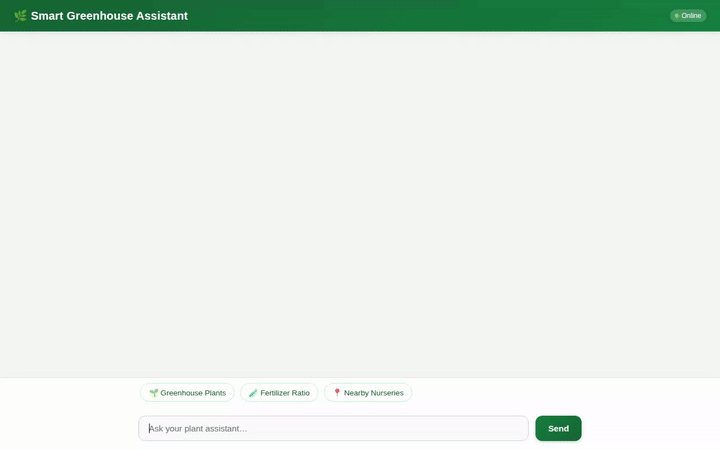

# 🌿 Smart Greenhouse Assistant

An intelligent, full-stack AI agent built with Google's Agent Development Kit (ADK) and deployed to Vertex AI Agent Runtime. The Smart Greenhouse Assistant helps plant enthusiasts manage greenhouse inventory, automate watering schedules, query real-time microclimate weather, locate nearby nurseries, run data analysis calculations, generate visual media, and retain user care preferences across sessions.



---

## 🚀 Wired Features & Tools

This repository contains fully implemented agent tools and Google Cloud service integrations:

### 1. 🪴 Plant Inventory & Care Management (Firestore)
- **`list_plants(category)`**: Queries the Cloud Firestore `plants` collection to list greenhouse items, with optional category filtering.
- **`get_plant_details(plant_id)`**: Fetches complete care requirements, sunlight needs, and notes for a specific plant.
- **`add_plant(...)`**: Registers new plant entries in Firestore.
- **`log_plant_care(plant_id, last_watered_date, notes)`**: Logs watering and fertilizing activities directly to Firestore documents.
- **`check_watering_schedule_alerts()`**: Evaluates plant watering frequencies against current dates and generates overdue watering alerts.

### 2. 🌦️ Environmental & Geolocation Intelligence
- **`get_environmental_weather_data(location_name)`**: Fetches live temperature, relative humidity, and rainfall data via Open-Meteo API for microclimate adjustments.
- **`geocode_address(address)`**: Converts addresses to latitude and longitude using Google Maps Geocoding API.
- **`find_nearby_places(latitude, longitude, place_type)`**: Locates nearby florists, nurseries, and garden supply stores using Google Places API (New).

### 3. 🎨 Multimodal Media Generation (Imagen & Omni)
- **`generate_plant_image(prompt)`**: Generates detailed plant photography using `gemini-3.1-flash-lite-image` in the global region. Uploads directly to Google Cloud Storage and saves as an ADK artifact.
- **`generate_plant_video(prompt)`**: Generates short plant scenes using Google's Omni model (`gemini-omni-flash-preview`). Saves ADK video artifacts and uploads MP4 files directly to Google Cloud Storage.

### 4. 🧮 Code Execution Sandbox
- **`AgentEngineSandboxCodeExecutor`**: Executes Python code in a secure Vertex AI Agent Engine sandbox to compute custom NPK fertilizer ratios, analyze growth metrics, or run mathematical modeling.

### 5. 🧠 Long-Term Cross-Session Memory
- **`VertexAiMemoryBankService`**: Integrates with Vertex AI Memory Bank to remember user facts, plant allergies, and care preferences across multiple chat sessions.

### 6. 📱 Rich UI Cards (A2UI) & Web Frontend
- **A2UI Protocol**: Generates structured JSON cards (Card, Column, Row, Text, Image) rendered natively in adk web and custom web frontends.
- **FastAPI Chat UI**: A lightweight FastAPI proxy server talking A2A protocol over Agent Engine passthrough with a custom botanical-themed dialogue web interface.

---

## 🛠️ Google Cloud Services Integrated

- **Vertex AI Agent Runtime / Agent Engine** (A2A deployment target)
- **Vertex AI Memory Bank** (managed long-term memory)
- **Vertex AI Code Execution Sandbox** (secure code execution)
- **Vertex AI Gemini Models** (`gemini-flash-latest`, `gemini-3.1-flash-lite-image`, `gemini-omni-flash-preview`)
- **Google Cloud Firestore** (plant document database)
- **Google Cloud Storage** (public asset storage bucket)
- **Google Maps Platform** (Geocoding API & Places API New)

---

## 💻 Local Setup & Development Instructions

### Prerequisites
- Python 3.10+
- Google Cloud SDK (`gcloud`) authenticated with a project containing enabled Vertex AI, Firestore, and Maps APIs.

### 1. Installation

Clone the repository and install agent dependencies:

```bash
pip install -r requirements.txt
```

### 2. Environment Configuration

Copy or create a `.env` file in the project root:

```env
GOOGLE_CLOUD_PROJECT=your-gcp-project-id
GOOGLE_CLOUD_REGION=us-east1
GOOGLE_MAPS_API_KEY=your-maps-api-key
```

### 3. Run the Agent Locally with ADK

To launch the interactive ADK development interface:

```bash
adk web app
```

### 4. Run the Web Frontend Locally

Navigate to the `frontend/` directory, install dependencies, and start the FastAPI server:

```bash
cd frontend
pip install -r requirements.txt
python main.py
```

Open a web browser and navigate to port `8080` on localhost.

---

## 🚀 Deployment Instructions

### Deploy Agent to Agent Runtime

Deploy the agent using `agents-cli`:

```bash
agents-cli deploy agent_runtime
```

### Deploy Frontend to Cloud Run

Deploy the FastAPI frontend proxy to Cloud Run:

```bash
gcloud run deploy smart-greenhouse-frontend \
  --source ./frontend \
  --region us-east1 \
  --allow-unauthenticated \
  --set-env-vars AGENT_ENGINE_RESOURCE_NAME="<YOUR_AGENT_RUNTIME_RESOURCE_NAME>",AGENT_DIRECTORY="app"
```
